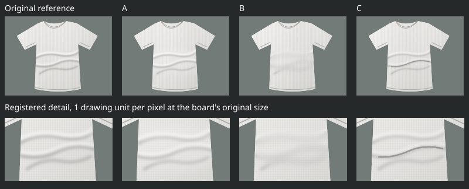
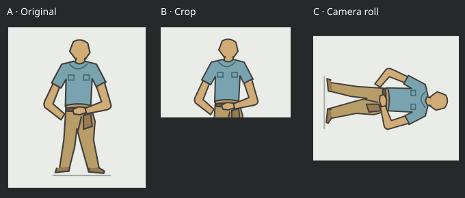

# Three independent visual tests

Start with the shirt comparison. It takes about 15 minutes and needs only the image below. The other two tests are independent. Each has a concrete stopping point. All fixtures are original synthetic examples. They exercise review methods without requiring the local application, photos, model weights or another GPU run.

## 1. Which repair restores the white shirt?



**Task.** Restore a missing patch in the center of the white shirt. Continue the folds, soft shadows and fine fabric pattern across the patch. Preserve the rest of the shirt and the background. The reference is the complete original before the patch was hidden. A, B and C are the returned composites at the same stage. One letter represents the same candidate in both rows. Open the board at its intrinsic 800 × 324 size for the detail comparison.

**First read, up to 10 minutes.** Look only at the rendered board. Give a separate verdict for the whole shirt and for the detail. Identify one fold by location and describe its direction, contrast or edge softness. Check whether fabric texture continues through the repair. Record ties or uncertainty, and say whether the differences merit rejection at normal viewing size. An answer that only names a letter is incomplete.

**After writing the verdict, up to 5 minutes.** Open [the second-read instructions](after-the-verdict.md). Keep the initial vote visible. If a measurement disagrees, say what each captured. This illustration is a fresh calibration test. Its rankings do not reproduce measurements or letter assignments from any historical photograph.

## 2. Is the stripe tonal banding or a blend seam?

The intended result is a smoothly shaded painted wall. The edit should preserve the paint color, gradient and surrounding wall. The untouched **Control** is known ground truth. A–D are final renders with fixed camera geometry. A second board shows those same frames after JPEG encoding.

Generate both boards on a CPU with Python, NumPy and Pillow. From the repository root, choose a new output directory:

```console
python review/wall.py wall-review
```

**First read, up to 10 minutes.** Inspect `board-png.png` at 1:1. Record the position and spacing of each visible stripe. Identify which candidates you can distinguish and where the available evidence runs out. Then inspect `board-jpg.png`: did compression create, obscure or change any sign that you relied on? If your environment cannot run the script, mark this test unrun. Reading the source gives away the constructions.

**Second read, up to 5 minutes.** Inspect the generator and pick the cheapest extra observation that would distinguish two causes in an actual editing pipeline. Explain what outcome would rule one of them out. Give an example where a final frame alone cannot settle the question.

## 3. What does the camera actually show?



The task here is observation. A is the original; B crops the same drawing; C rolls the entire view by a quarter turn. Clothing details, hands and body relationships are protected. There is no hidden second pose or measured 3D ground truth.

**One read, up to 10 minutes.** For each panel describe the upper torso, pelvis, legs and hands separately. For each region name the visible cue, its orientation relative to the camera if supported, and any obstruction or crop. Distinguish an obscured landmark from one outside the frame. Identify one conclusion changed by cropping and one that should survive camera roll. An unsupported precise angle counts as a failure.

## What to return

For each test give the observation, its supporting evidence, your confidence, and one remaining uncertainty. Distinguish actions you actually ran from inferences based on the pictures. The result we want is a review rule we could check on another scene.
