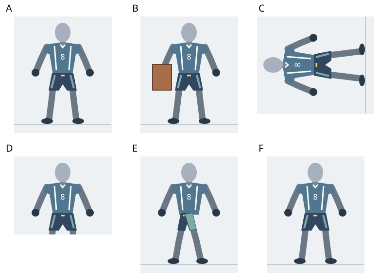

# Which way is each part of the athlete facing?

Design the smallest pose-analysis change that could describe a turn at the waist while admitting when the hands, head or legs provide too little evidence. Budget 20 minutes. Use the synthetic sports mannequin below. The task is observation and routing. Preserve the source framing, clothing and pose. No image edit or model installation is needed.

## What the current code supplies

The local pose analyzer returns one person box, 17 two-dimensional landmarks with raw keypoint scores, one whole-person view label and a posture estimate. Its detection gate treats scores above 2.5 as reliable for that gate. The score has no calibrated probability or occlusion meaning. The landmarks include wrists and ankles. They provide no finger, palm or foot-surface orientation.

The analyzer can try quarter turns for detection and produce a body-aligned crop. It stores points in the original image and in the resized crop. The working rotation and proposed delivery rotation are separate. A scene-edge check can support camera roll. A shoulder-to-hip axis alone cannot resolve gravity. For this exercise, use the original-frame points. The analyzer currently supplies no per-region facing or occluder labels. These statements describe the inspected code path. No detector was run on the drawings.

## First read

Use the [board](board.svg) for visible evidence and the matching [landmark packets](landmarks.json) as detector-like observations. All coordinates and scores were authored by hand. Each packet gives frame size and triples of normalized x, normalized y and raw synthetic score. The origin is the top left of that panel. Right and down are positive. Pixel centers span 0 to width−1 and 0 to height−1. Null coordinates mean no observation. Left and right in landmark and region names are the athlete's anatomical sides.

Group the observations into **head, upper torso, pelvis, left/right arm, left/right hand, and left/right leg**. Record these fields for each group. You can group rows that agree and list just the differences from A in later panels.

| Field | Allowed values or evidence |
| --- | --- |
| facing relative to camera | front / oblique / unknown. Use garment fronts, visible side surfaces, or another named local cue. A limb's tilt in the image is a separate 2D observation. |
| extent in frame | full / partial / outside / unknown |
| visibility of the in-frame part | clear / partial / hidden / unknown |
| occluding object | none seen / self / object / unknown. Use unknown for unavailable evidence. |
| evidence | name a pixel cue and/or landmark pair, and explain any disagreement |

Which panels could a point-only rule confuse? Identify the first region where a single global view loses information. Record your verdict before requesting the operator key. Then carry those observations into the [downstream architecture exercise](../pose-consumers/README.md).

## What to return

1. Return the regional rows above, with one unknown you would preserve in a production result. Explain what evidence would change it.
2. Compare two implementable options. For the first, specify a deterministic rule over existing points and scores, its units, frame handling, and abstention gate. For the second, name an existing model or image cue you would use, its actual inputs, extra CPU cost to measure, and one failure it might introduce. State which components already exist and which would need integration. Treat an unexecuted model as a proposal.
3. Design a CPU comparison against copying the whole-person view to every region. Freeze thresholds before testing. Specify the original control, obscured hand, quarter turn, crop, and mixed torso/pelvis case. Report supported calls, unsupported confident calls, abstentions on answerable regions, and pairwise invariants separately. Name a result that would make you remove the proposed rule.
4. Give the smallest interface change, its caller and a fallback when evidence is insufficient. State what result would justify moving from this fixture to one independently drawn athlete. Deliver a table and test design in chat or a file. If you return code, include a standalone callable, its dependencies, a command that runs on the supplied JSON, and tests for the rotation and crop. Report any case where the landmarks alone cannot distinguish two images.
